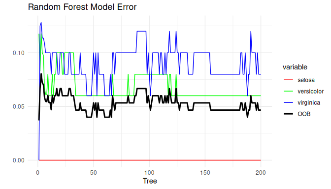
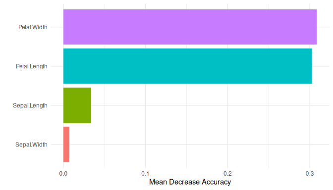
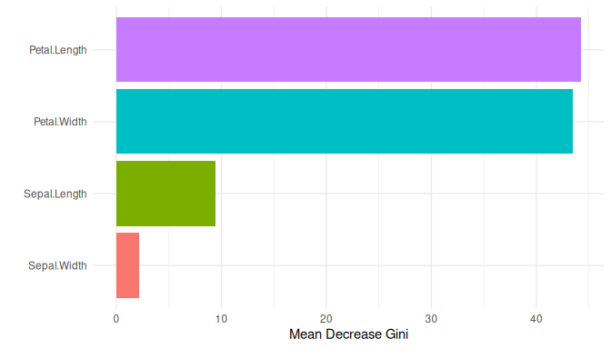
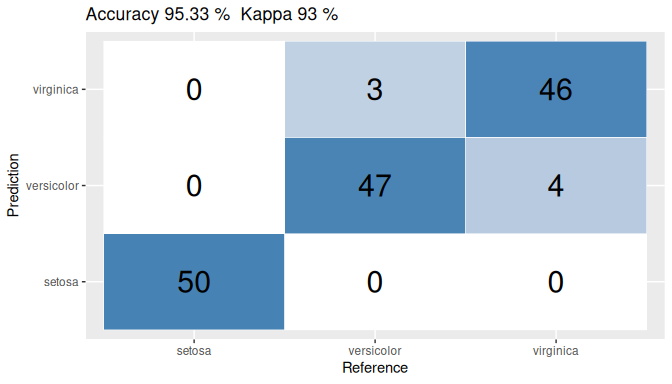

<!-- README.md is generated from README.Rmd. Please edit that file -->

<figure>

<figcaption aria-hidden="true">License</figcaption>
</figure>

# ggmodel

R package to `ggplot2` Machine Learning models: error rate and variable
importance of `randomForest` models, and `caret` confusion matrices.

## Installation

You can install the development version of `ggmodel` from
[GitHub](https://github.com/EnriquePH/ggmodel) with:

``` r
# install.packages("pak")
pak::pak("EnriquePH/ggmodel")
```

## Example

``` r
library(ggmodel)

set.seed(1)
model <- randomForest::randomForest(Species ~ ., data = iris,
                                    ntree = 200, importance = TRUE)

ggplotModel(model)
```

<!-- -->

``` r
ggMeanDecreaseAccuracy(model)
```

<!-- -->

``` r
ggMeanDecreaseGini(model)
```

<!-- -->

``` r

m <- caret::confusionMatrix(predict(model), iris$Species)
ggConfusionMatrix(m)
```

<!-- -->

Models trained with `caret::train(method = "rf")` work too: pass their
`finalModel`.

## Links

[Package ‘caret’](https://CRAN.R-project.org/package=caret)
